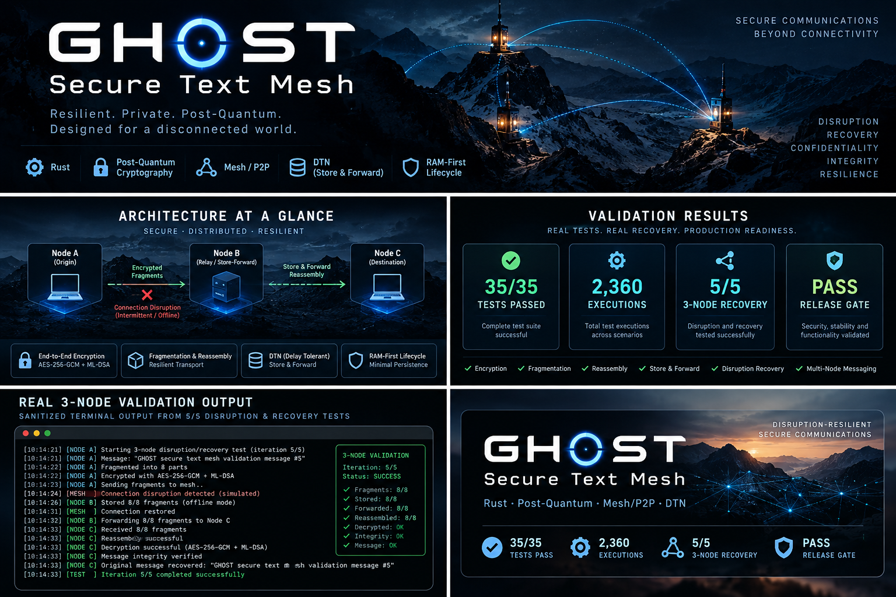
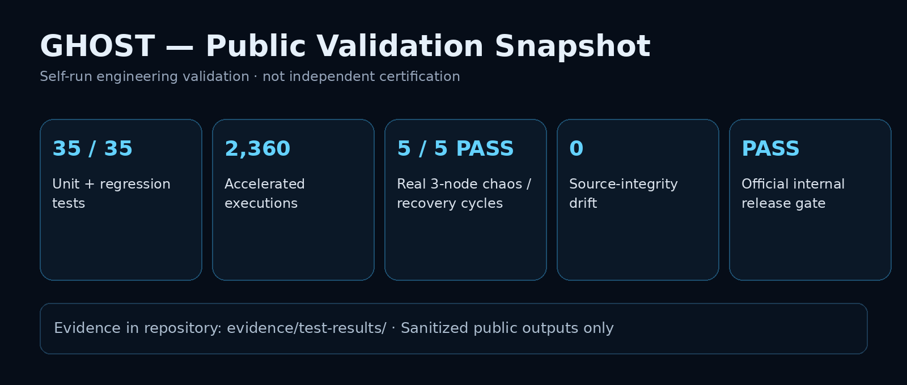
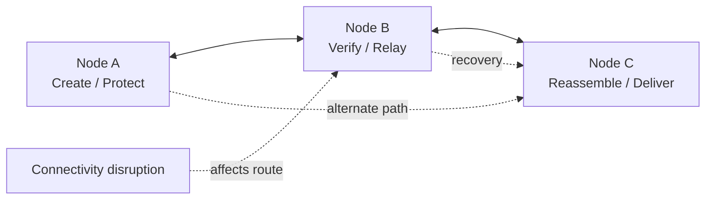

<!-- GHOST-DEMO-V1-PUBLIC-PREVIEW -->
## GHOST Demo v1.0 — Real Independent Technical Preview

The `evaluation-demo/` directory contains **actual Rust demo source**, not a
mock and not the private Production Core. Visitors can now use **git clone + Cargo** or **GitHub Releases ZIPs** (Linux/Windows).

- [Source, scope, clone/build/run instructions](evaluation-demo/README.md)
- [Download Demo v1.0 — Linux and Windows](https://github.com/s7nHan/Ghost-securetextmesh/releases/tag/demo-v1.0.0)
- [Limited evaluation source license](evaluation-demo/LICENSE-EVALUATION.md)
- [Third-party license materials](evaluation-demo/THIRD-PARTY-NOTICES.md)

The limited preview demonstrates ML-KEM, ML-DSA, AES-256-GCM, Shamir, local
QUIC mesh, DTN disconnect/reconnect, signed acknowledgment and bounded RAM
queueing. The basic demo uses three nodes in one process; the isolated runner
also exercises **three OS processes**. It is a scripted technical evaluation,
not an interactive chat product, a multi-host field deployment or a security
certification. This PUBLIC preview is distinct from the separately discussed
USD 2,000 private commercial evaluation program.

> **Secure communication should not depend on perfect network conditions — or blind trust in those who administer the system.**
>
> **GHOST Secure Text Mesh** is a RAM-first, decentralized, text-only secure communication architecture designed for operational resilience, confidentiality, and integration into mission-critical environments.

**[Download for Linux](https://github.com/s7nHan/GHOST-Demo-v1/releases/download/demo-v1.0.0/GHOST-Demo-v1.0-Linux-x86_64.zip)** | **[Download for Windows](https://github.com/s7nHan/GHOST-Demo-v1/releases/download/demo-v1.0.0/GHOST-Demo-v1.0-Windows-x86_64.zip)** | **[View Demo Source](https://github.com/s7nHan/GHOST-Demo-v1/tree/main/evaluation-demo)**

---

## Why GHOST Exists

### Security. Privacy. Independence. Operational Continuity.

In an era of geopolitical uncertainty, regional conflicts, cyber threats, and increasing dependence on digital infrastructure, secure communication is no longer simply a matter of convenience.

For defense organizations, intelligence operations, critical infrastructure operators, and institutions managing sensitive information, communication security can become a fundamental component of operational continuity.

What happens when centralized infrastructure becomes unavailable?

What happens when network connections are interrupted, communication channels are compromised, or an organization cannot depend on external messaging services?

And perhaps most importantly:

**Who should have the authority to access private communications — including the administrator who deployed the system?**

GHOST Secure Text Mesh was developed to address these questions through a different approach to secure communication engineering.

## Not Another Messaging Application

GHOST is not intended to compete with conventional consumer messaging platforms.

It is not designed around social networking, group conversations, media sharing, user profiles, or centralized message archives.

**GHOST focuses exclusively on secure, text-based communication.**

Its architecture brings together decentralized networking, multiple interconnected nodes, post-quantum cryptography, memory-oriented message handling, and controlled security mechanisms.

The objective is not necessarily to replace an organization's existing systems.

**The objective is to provide a security-focused communication component that can be evaluated, adapted, and integrated into existing operational environments.**

## Security Must Extend Beyond Administrator Privileges

A fundamental design principle behind GHOST is that administrative authority should not automatically provide access to private message contents.

The person who deploys, configures, or maintains a communication system should not inherently possess the cryptographic authority to read every message passing through it.

GHOST is designed around the principle of minimizing privileged access to sensitive communications.

**No intentional administrator-access backdoor is part of the project's security objectives.**

This is an architectural commitment rather than a claim of independent certification. Production deployments must be assessed through appropriate code review, security testing, key-management verification, and environment-specific validation.

The goal is straightforward:

**Confidential communication should remain under the control of its authorized participants.**

## RAM-First Architecture: Minimizing Persistent Data Exposure

Traditional communication systems may rely on databases, centralized message histories, persistent storage, and backup infrastructure.

GHOST follows a different design philosophy.

Its RAM-first approach prioritizes memory-oriented message processing and reducing unnecessary persistent traces throughout the message lifecycle.

The project is not intended to operate as a centralized message storage, archival, or user-data collection service.

Its engineering goals include:

- Minimizing persistent message-content storage.
- Avoiding centralized message archives and routine server-side backups.
- Enforcing message lifetime and resource boundaries.
- Reducing unnecessary exposure of sensitive communication data.
- Keeping message handling aligned with clearly defined security controls.

Absolute absence of recoverable data cannot be guaranteed across arbitrary operating systems, endpoints, network environments, or third-party integrations. These factors require deployment-specific controls and verification.

**The principle remains clear: sensitive communications should not be retained merely because a communication service exists.**

## Decentralized Communication and Network Resilience

GHOST is designed to reduce dependence on a single centralized messaging server.

Its peer-to-peer and mesh-oriented architecture allows participating nodes to communicate through supported network paths.

Delay-Tolerant Networking (DTN) mechanisms are intended to support message handling during intermittent connectivity, subject to defined time, security, and resource constraints.

This does not mean that every network outage can be overcome or that communication can continue without any available path.

It means the architecture is designed to improve resilience when network conditions become unstable.

**Resilience is not the absence of failures. It is the ability to manage failures without abandoning security principles.**

## Integrated Cryptographic Security

GHOST does not rely on a single cryptographic mechanism as its complete security model.

Its architecture integrates several technologies and protective controls, including:

- **ML-KEM:** Post-quantum key encapsulation.
- **ML-DSA:** Post-quantum digital signatures.
- **AES-256-GCM:** Authenticated encryption.
- **Shamir Secret Sharing:** Threshold-oriented secret distribution.
- **P2P / Mesh:** Decentralized communication architecture.
- **DTN:** Delay-tolerant message handling.
- **Replay protection:** Controls against repeated or invalid message processing.
- **TTL and resource limits:** Bounded message lifecycles and resource usage.
- **Multi-node communication:** Distributed operational scenarios.

The value proposition is not simply the presence of these individual technologies.

**It is their integration into a coherent communication architecture designed around confidentiality, integrity, resilience, and controlled message lifecycles.**

## Designed With Mission-Critical Environments in Mind

GHOST was conceived with demanding communication environments in mind, particularly those relevant to:

- Defense and security technology.
- Authorized intelligence and operational communications.
- Critical infrastructure.
- Cybersecurity engineering.
- Sensitive institutional communication.
- Distributed and resilience-focused systems.

Its intended role is to provide organizations with a technology they can evaluate and potentially incorporate into their own infrastructure.

GHOST is not presented as a certified military communications product or as a validated substitute for existing mission-critical systems.

Instead, it offers a technical foundation for controlled evaluation, integration, and further development.

## GHOST Demo v1.0 — Technology You Can Evaluate

GHOST is no longer presented solely through conceptual documentation.

**GHOST Demo v1.0 is publicly available.**

The evaluation release includes real Rust source code, technical documentation, test scenarios, and prebuilt Linux and Windows packages.

The limited demonstration enables technical reviewers to examine selected capabilities, including:

- Three-node local communication scenarios.
- Cryptographic operations.
- Connection interruption and recovery.
- Message lifecycle management.
- Security behavior and adversarial tests.
- Decentralized runtime components.

This release is intentionally limited and does not expose the private GHOST Production Core.

It is not an independently certified security product or a representation of unrestricted production capabilities.

**Review the source. Run the evaluation. Examine the behavior. Assess the technology against your requirements.**

## Integration, Licensing, and Intellectual Property

GHOST Secure Text Mesh is open to technical and commercial discussions.

Potential arrangements include:

- Controlled private technical evaluations.
- Enterprise integration and custom development.
- Commercial technology licensing.
- Strategic engineering partnerships.
- Intellectual property acquisition or transfer.

The scope, rights, delivery obligations, and commercial terms of each arrangement would be determined through direct discussion.

**GHOST is intended to be evaluated not only as software, but also as an adaptable communication technology.**

## Development and Future Availability

The development of GHOST Secure Text Mesh is intended to continue, either independently or through suitable institutional collaboration.

As the engineer directing the project, I remain open to supporting its continued development, technical validation, and integration into authorized environments.

The long-term objective is to provide organizations and individuals with greater control over their own secure communication infrastructure, without building a business model around the collection or monetization of private message contents.

Subject to sufficient technical and commercial interest, the planned next stage includes:

- An independent official website.
- A proposed **30-day free evaluation period** for a more comprehensive release.
- Three commercial packages serving different operational and integration requirements.
- Organization-specific integration and technical support options.
- Continued security hardening and evaluation.

These are planned offerings, not currently available production services or unconditional commitments.

## The Mission

GHOST Secure Text Mesh was not created to become another everyday messaging application.

It was created to explore a more demanding objective:

**A decentralized, text-only communication architecture where strong cryptography, minimal data persistence, operational resilience, and clearly bounded administrative authority work together.**

In a world where communication infrastructure can become a point of vulnerability, secure communication deserves to be treated as an engineering responsibility rather than a marketing promise.

**GHOST Secure Text Mesh**

*Built for Resilience. Designed for Security.*

---


---

# GHOST Secure Text Mesh



### Secure text communication designed for disrupted, multi-node environments.

**Private implementation · Public technical evidence · Showcase repository**

> GHOST is a Rust-based secure text communication system focused on resilient multi-node delivery, cryptographic protection, disruption recovery, and a RAM-first message lifecycle.

> **Artwork note:** the header image is illustrative showcase artwork. Factual validation claims are the text and evidence files published below.

[Technical Overview](docs/TECHNICAL-OVERVIEW.md) · [Architecture](docs/ARCHITECTURE.md) · [Validation](docs/VALIDATION.md) · [Public Evidence](evidence/EVIDENCE-MANIFEST.md) · [Evaluation Interest Group](INTEREST-GROUP.md)

---

### GHOST Demo v1.0 — Officially Released | November 2, 2026

**GHOST Secure Text Mesh Demo v1.0 is now available on GitHub.**

After extensive development and technical validation, GHOST's first public evaluation demo is officially released.

The repository now includes real, runnable Rust evaluation source code, while the official GitHub Release provides prebuilt packages for Linux and Windows x86-64.

This free, limited technical preview allows developers, security researchers, and engineering teams to explore selected GHOST capabilities independently.

**Access GHOST Demo v1.0**

- [Explore the demo source and instructions](https://github.com/s7nHan/Ghost-securetextmesh/tree/main/evaluation-demo)
- [Download the Linux and Windows demo packages](https://github.com/s7nHan/Ghost-securetextmesh/releases/tag/demo-v1.0.0)
- [View the technical documentation](https://github.com/s7nHan/Ghost-securetextmesh)
- [Join the technical discussion](https://github.com/s7nHan/Ghost-securetextmesh/discussions)

**What can you evaluate?**

The preview demonstrates selected post-quantum cryptographic operations, AES-256-GCM, Shamir secret sharing, local three-node QUIC mesh communication, DTN reconnection behavior, signed acknowledgments, and bounded RAM queueing.

This is an independent, non-production technical demonstration. It is not the private GHOST Production Core, a full messaging application, or an independent security certification.

**Explore the source. Run the demo. Examine the results.**

*GHOST Secure Text Mesh — Built for resilience. Designed for security.*

---


### Early Technical Evaluation

GHOST is welcoming interest from cybersecurity professionals, researchers, and organizations exploring resilient and secure communications.

Review the public technical evidence and register your interest in upcoming controlled demonstrations.

**[→ Explore GHOST Evaluation Access](https://github.com/s7nHan/Ghost-securetextmesh/discussions/1)**


### GHOST at a Glance

- **Built with Rust** — Security-focused system development.
- **P2P / Mesh Networking** — Distributed multi-node communication.
- **DTN Resilience** — Communication across disrupted networks.
- **Post-Quantum Security** — ML-DSA digital signatures.
- **RAM-First Processing** — Memory-focused message lifecycle.
- **Technical Evaluation** — Public architecture and validation evidence available.


## What GHOST is

GHOST is engineered for environments where a communication system cannot safely assume that connectivity will remain continuous, routes will remain stable, or incoming traffic will always be valid.

### Technology combination

The current GHOST implementation and public system description combine:

- **Rust** as the primary implementation language;
- **Tokio** for asynchronous runtime, networking, and concurrency orchestration;
- **ML-DSA** for post-quantum digital signatures;
- **ML-KEM** for post-quantum key-establishment / encapsulation workflows;
- **AES-256-GCM** for authenticated encryption;
- **Shamir Secret Sharing** for threshold secret-sharing workflows;
- **P2P / mesh-oriented multi-node communication**;
- **delay / disruption-tolerant networking (DTN) behavior**;
- **secure fragmentation and reassembly**;
- **nonce / replay protection**;
- **Proof-of-Work validation controls**;
- **TTL, timeout, rate and resource controls**;
- a **RAM-first message lifecycle** intended to minimize persistent message material.

The production implementation remains private. This repository exists to show the architecture, validation scope, public Rust system model, and observable engineering evidence without publishing sensitive source code or deployment internals.

### Public Rust showcase

A small, non-production Rust example is included under [`examples/rust-showcase/`](examples/rust-showcase/). It demonstrates safe high-level lifecycle orchestration with **Tokio** and public algorithm labels, while intentionally omitting production cryptography, protocol internals, routing logic, secrets, and deployment configuration.

The Python file under `scripts/` is repository preflight tooling rather than product implementation, so it is excluded from GitHub Linguist's language bar through `.gitattributes`. This keeps the public repository language summary aligned with the Rust-based product while remaining explicit about what the published example is and is not.

---

## Real validation output

The public showcase uses sanitized text output from the real validation archive rather than staged screenshots.

```text
=== CLEAN STRICT PRODUCTION 3-NODE E2E ===

=== PRODUCTION MEMORY POLICY ===
memory_lock = true
require_memory_protection = true

=== RUN E2E ===
E2E 3-NODE: PASS
(multi-fragment delivery after disconnect/reconnect + authenticated IPC/admin)

=== E2E EXIT CODE: 0 ===
```

[Open the sanitized 3-node E2E output](evidence/test-results/three-node-e2e-pass.txt)

### Validation snapshot



| Validation item | Recorded result |
|---|---:|
| Unit + regression tests | **35 / 35 PASS** |
| Accelerated executions | **2,360** |
| Real 3-node chaos / recovery cycles | **5 / 5 PASS** |
| Source-integrity drift | **0** |
| Official internal release gate | **PASS** |

[Open the sanitized validation summary](evidence/test-results/public-validation-summary.txt)

> These results come from self-run engineering validation. They are **not** independent certification, formal verification, third-party penetration testing, or government/security accreditation.

---

## Four engineering pillars

### 1. Attack / resource rejection

Tamper, replay, malformed input, bounded allocation and fail-closed controls are part of the validation scope.

### 2. Cryptography

The system combines AES-256-GCM authenticated encryption, ML-DSA signatures, ML-KEM key-establishment workflows, Shamir threshold secret sharing, validation controls and key lifecycle handling.

### 3. Multi-node continuity

The validated flow includes real 3-node operation, disconnect / reconnect behavior and multi-fragment delivery.

### 4. RAM-first lifecycle

The intended message flow is:

```text
CREATE → PROTECT → SIGN → FRAGMENT → TRANSPORT → VERIFY → REASSEMBLE → DELIVER → CLEANUP
```

The design goal is to minimize persistent plaintext, message-key and fragment/share material.

---

## Architecture at a glance



The public architecture intentionally stops at the system boundary. See [Architecture](docs/ARCHITECTURE.md) for the high-level design.

---

## Core capabilities

- Rust-based implementation with Tokio asynchronous orchestration
- Peer-to-peer / mesh-oriented multi-node communication
- Delay / disruption-tolerant networking concepts
- Multi-node end-to-end message transfer
- ML-DSA digital signatures
- ML-KEM key-establishment / encapsulation workflows
- AES-256-GCM authenticated encryption
- Shamir threshold secret sharing
- Secure message fragmentation and reassembly
- Signature and message verification
- Nonce / replay protection
- Proof-of-Work based validation controls
- TTL / timeout controls
- Rate and resource controls
- Firewall / lockdown controls where configured
- RAM-first message handling
- Key lifecycle handling

Public documentation describes system-level behavior only. Production source code, secrets, private keys, exploit-relevant internals, and deployment-sensitive configuration are intentionally excluded.

---

## Public Demo v1.0 — Available Now

**The free, limited technical demo was released on November 2, 2026.**

- [Browse evaluation source and run instructions](evaluation-demo/README.md)
- [Download Linux and Windows packages](https://github.com/s7nHan/Ghost-securetextmesh/releases/tag/demo-v1.0.0)
- [Review the evaluation license](evaluation-demo/LICENSE-EVALUATION.md)

The public demo is separate from any future controlled private evaluation. The private Production Core remains undisclosed.

---


## Evaluation Interest Group

A future limited GHOST Technical Evaluation is planned around a **USD 2,000 reference price**.

This repository contains a public, GitHub-native interest group for people and organizations who want to signal genuine evaluation / purchase intent before availability opens.

### Join inside this repository

**Discussions → Evaluation Interest → New discussion**

The structured entry asks participants to confirm that they:

- have seen the planned **USD 2,000** reference price;
- currently intend to consider purchasing the evaluation if it becomes available on substantially the described terms;
- want to remain in the public Evaluation Interest Group while availability is pending;
- understand that joining is non-binding and requires no payment now.

Each participant creates one public entry. The **Evaluation Interest** Discussions category itself becomes the visible group/list. No external waitlist, email form, landing page, checkout, or third-party signup is used.

[Read exactly what joining means](INTEREST-GROUP.md) · [Read the planned evaluation scope](EVALUATION.md)

### Issues remain open

GitHub **Issues** remains available separately for technical, integration, licensing and collaboration questions through the existing `Evaluation / Collaboration Interest` template.

> Do not include confidential, classified, credential, private-key, exploit, or sensitive infrastructure information in public Discussions or Issues.

---

## Intended audience

GHOST may be relevant to professionals and organizations working in:

- Secure communications
- Cybersecurity infrastructure
- Defense and mission-critical systems
- Resilient / disruption-tolerant networking
- Disconnected or intermittently connected environments
- Emergency communications
- Secure edge systems
- Applied cryptography

---

## Repository boundaries

### This repository is

- A public technical showcase
- A high-level architecture reference
- A home for sanitized validation evidence
- A small public Rust lifecycle example
- A public Evaluation Interest Group plus a separate technical entry point for questions

### This repository is not

- The production development repository
- An open-source release of the GHOST production implementation
- A production deployment package
- A repository of private keys, credentials, secrets or sensitive protocol internals
- A claim of independent security certification

---

## Documentation

- [Technical Overview](docs/TECHNICAL-OVERVIEW.md)
- [Architecture](docs/ARCHITECTURE.md)
- [Security Model](docs/SECURITY-MODEL.md)
- [Threat Model](docs/THREAT-MODEL.md)
- [Validation](docs/VALIDATION.md)
- [Public Claims & Evidence Gate](docs/PUBLIC-CLAIMS.md)
- [Public Evidence Manifest](evidence/EVIDENCE-MANIFEST.md)
- [FAQ](docs/FAQ.md)
- [Evaluation Interest Group](INTEREST-GROUP.md)
- [Technical Evaluation](EVALUATION.md)
- [Public Rust Showcase](examples/rust-showcase/README.md)

---

## Project status

**Technical showcase ready · Production implementation private · Demo v1.0 publicly released · Evaluation Interest Group enabled through repository Discussions**

© 2026 GHOST Secure Text Mesh. All rights reserved unless otherwise stated.

## Commercial rights and evaluation restrictions

The public demo is licensed for technical evaluation only. Downloading, testing, cloning or running it grants no ownership, commercial use, redistribution, integration, resale or Production Core rights in GHOST-owned materials. See `evaluation-demo/LICENSE-EVALUATION.md`. Third-party components retain their own license terms.
